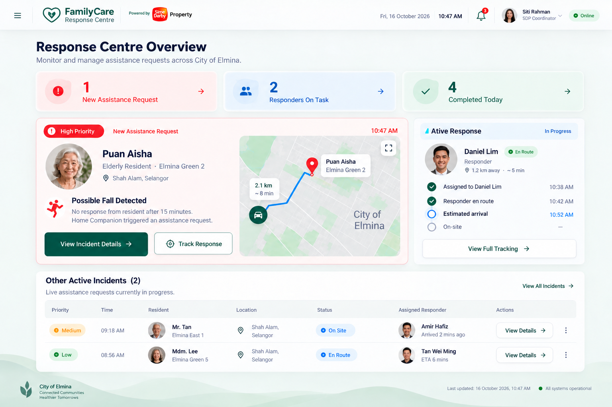
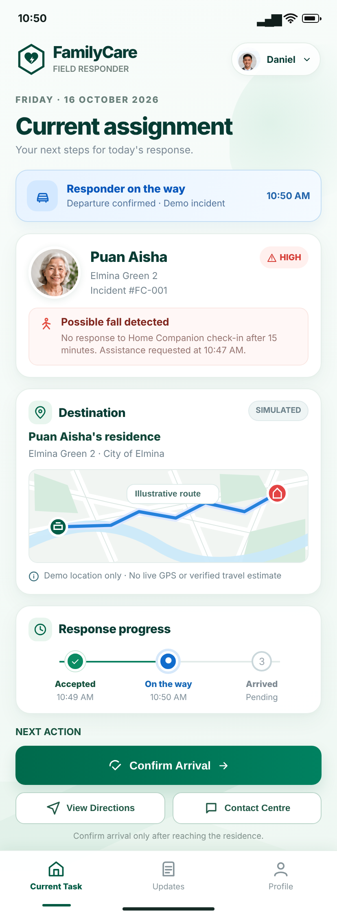

# FamilyCare submission support and backup pack

Use this page only as supporting material. The pitch deck, final demo-video link, and primary live-prototype link remain the main submission artifacts.

## Primary live links

- FamilyCare mobile app: https://familycare-sdp-hackathon.onrender.com/
- Home Companion: https://familycare-sdp-hackathon.onrender.com/companion
- SDP Coordinator Response Center: https://familycare-sdp-hackathon.onrender.com/coordinator
- SDP Responder Dashboard: https://familycare-sdp-hackathon.onrender.com/responder
- Sensor Simulator — demo only: https://familycare-sdp-hackathon.onrender.com/simulator
- API documentation: https://familycare-sdp-hackathon.onrender.com/docs

## Backup screenshots

These approved interface references preserve the core story if the hosted prototype is temporarily unavailable.

### Family dashboard

### Possible-fall incident

### SDP response centre

### Field responder

Additional approved screens are available in [the family-dashboard folder](../designs/family-dashboard/) and [the responder-dashboard folder](../designs/responder-dashboard/).

## Technical evidence

- [Fall-detection evaluation](fall-model-evaluation.md)
- [API contract](api-contract.md)
- [IWR6843 integration plan](iwr6843-integration.md)
- [System test plan](test-plan.md)

## Short disclosure note

> FamilyCare is a hackathon prototype. Demo incidents and sensor triggers are simulated. The fall-detection model was evaluated on 102 recorded samples from three participants and is not clinically validated. Live radar hardware, authentication, durable production storage, verified location data, and real emergency dispatch remain future pilot work.

Use this note in the video description, submission notes, or appendix where appropriate.

## Final-video backup

After the final video is recorded:

- Upload the primary copy as an unlisted YouTube video or view-only Drive file.
- Keep a second MP4 named `FamilyCare_Demo_Backup.mp4` in a separate team-owned Drive folder.
- Test both links from a private browser window and a second device.
- Keep captions or a transcript with the backup.
- Do not commit the MP4 to Git; repository downloads and judging should not depend on a large binary file.

The backup-video URL is intentionally not listed here until the final recording exists. Add the confirmed link only after testing its permissions.
