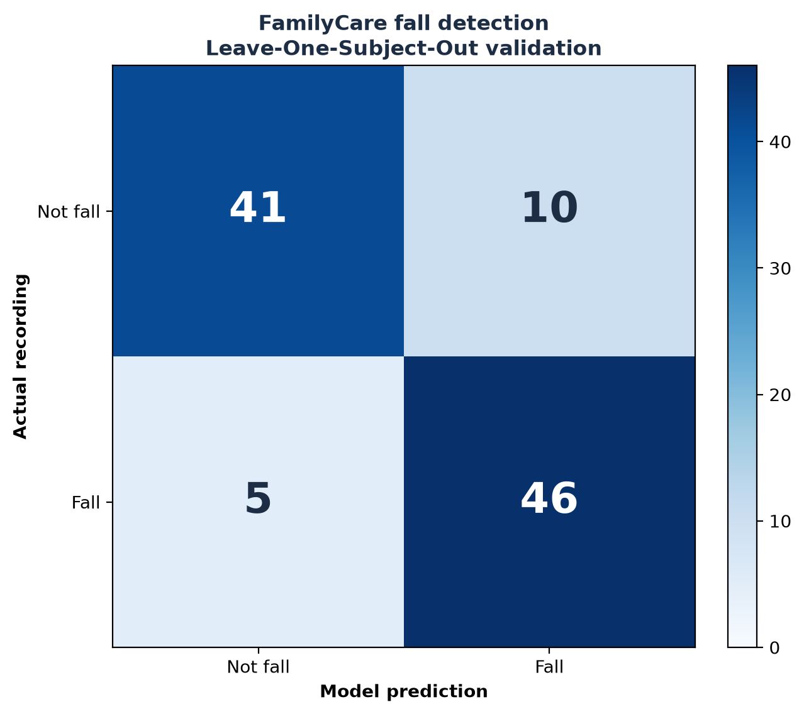
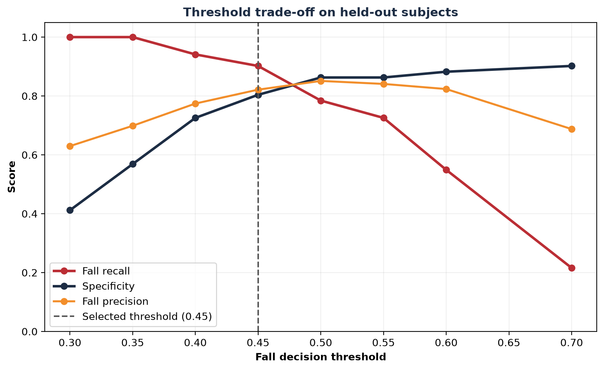
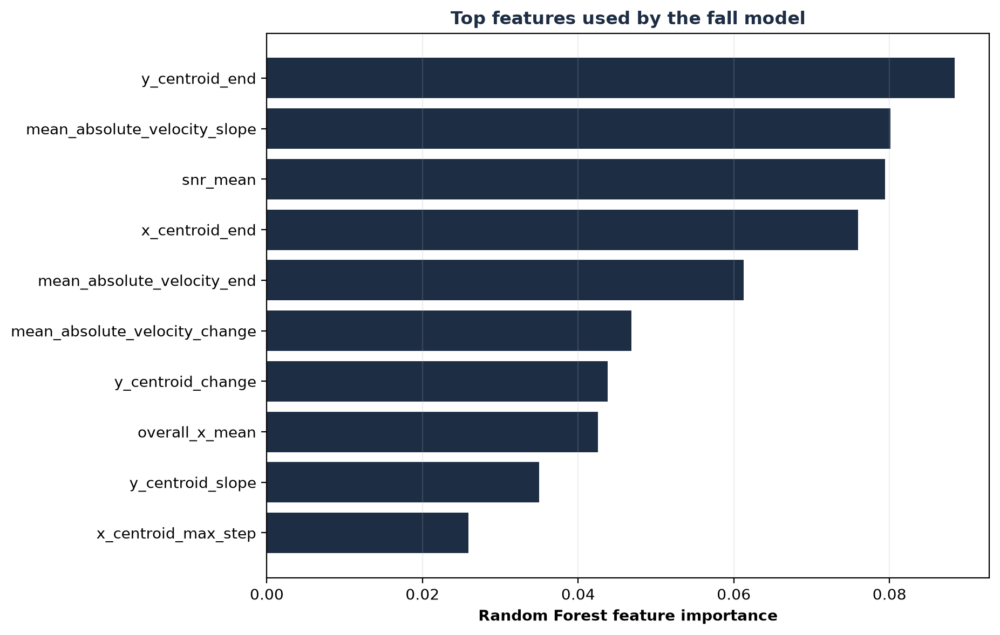

# FamilyCare Fall-Detection Evaluation

## Executive result

The Random Forest was evaluated using **Leave-One-Subject-Out (LOSO)
cross-validation**. In each fold, one participant was completely excluded
from training and used only for testing. This is more realistic than a random
row split because recordings from the same person cannot appear in both the
training and test sets.

At the selected threshold of **0.45**, the prototype achieved:

- **90.2% fall recall:** 46
  of 51 falls detected.
- **85.3% balanced accuracy.**
- **82.1% fall precision.**
- **80.4% specificity:**
  41 of
  51 normal activities
  correctly rejected.
- **10 false positives** and
  **5 false negatives** across
  **102 recordings** from **3 participants**.

These are preliminary prototype results, not clinical-performance claims.

## Evaluation design

- Dataset size: 102 recordings.
- Participants: Areeb, Raffay, Towsif.
- Class balance: 51 fall and
  51 non-fall recordings.
- Model: Random Forest using 82 extracted point-cloud and motion features.
- Decision rule: classify as a possible fall when the fall score is at least
  0.45.
- The fall score is a model confidence score, not a medically calibrated
  probability.

## Overall confusion matrix

| Actual / predicted | Not fall | Fall |
| --- | ---: | ---: |
| Not fall | 41 | 10 |
| Fall | 5 | 46 |

## Results by held-out participant

| Held-out participant | Recordings | Balanced accuracy | Fall recall | Specificity | False positives | False negatives |
| --- | --- | --- | --- | --- | --- | --- |
| Areeb | 34 | 94.1% | 94.1% | 94.1% | 1 | 1 |
| Raffay | 34 | 73.5% | 100.0% | 47.1% | 9 | 0 |
| Towsif | 34 | 88.2% | 76.5% | 100.0% | 0 | 4 |

The variation between participants is important. The Raffay fold detected
every fall but produced more false alerts, while the Towsif fold rejected all
normal activities but missed four falls. This shows that the next dataset
must include more people and more variation in movement style.

## False-alert analysis

### False positives: normal activity classified as a fall

| Activity | False positives | Participant(s) |
| --- | --- | --- |
| walk | 7 | Raffay |
| bow | 2 | Raffay |
| squat | 1 | Areeb |

Walking accounted for most false positives, and all seven walking errors came
from the same held-out participant. This suggests person-specific movement or
radar-position differences rather than a universal walking problem. The
appropriate response is to collect more walking styles and sensor placements,
not to claim that the issue is already solved.

### False negatives: fall classified as normal activity

| Fall direction | False negatives | Participant(s) |
| --- | --- | --- |
| front | 3 | Towsif |
| back | 1 | Areeb |
| side | 1 | Towsif |

The complete recording-level error list is stored in
`fall_detection/reports/fall_error_analysis.csv`.

## Performance by activity

| Class | Activity | Recordings | Errors | Accuracy | Mean fall score |
| --- | --- | --- | --- | --- | --- |
| Fall | back | 15 | 1 | 93.3% | 0.584 |
| Fall | front | 21 | 3 | 85.7% | 0.587 |
| Fall | side | 15 | 1 | 93.3% | 0.652 |
| Not | bow | 15 | 2 | 86.7% | 0.323 |
| Not | squat | 15 | 1 | 93.3% | 0.350 |
| Not | walk | 21 | 7 | 66.7% | 0.381 |

## Decision-threshold trade-off

| Threshold | Fall recall | Specificity | Fall precision | False positives | False negatives |
| --- | --- | --- | --- | --- | --- |
| 0.30 | 100.0% | 41.2% | 63.0% | 30 | 0 |
| 0.35 | 100.0% | 56.9% | 69.9% | 22 | 0 |
| 0.40 | 94.1% | 72.5% | 77.4% | 14 | 3 |
| 0.45 (selected) | 90.2% | 80.4% | 82.1% | 10 | 5 |
| 0.50 | 78.4% | 86.3% | 85.1% | 7 | 11 |
| 0.55 | 72.5% | 86.3% | 84.1% | 7 | 14 |
| 0.60 | 54.9% | 88.2% | 82.4% | 6 | 23 |
| 0.70 | 21.6% | 90.2% | 68.8% | 5 | 40 |

The selected threshold of 0.45 intentionally prioritizes fall
recall. Raising it may reduce false alerts but risks missing more falls. The
threshold must be reviewed again after collecting a larger, representative
IWR6843 dataset.

## Model explanation

| Rank | Feature | Importance |
| --- | --- | --- |
| 1 | y_centroid_end | 0.0884 |
| 2 | mean_absolute_velocity_slope | 0.0802 |
| 3 | snr_mean | 0.0794 |
| 4 | x_centroid_end | 0.0760 |
| 5 | mean_absolute_velocity_end | 0.0613 |
| 6 | mean_absolute_velocity_change | 0.0469 |
| 7 | y_centroid_change | 0.0438 |
| 8 | overall_x_mean | 0.0426 |
| 9 | y_centroid_slope | 0.0350 |
| 10 | x_centroid_max_step | 0.0259 |

The model uses a combination of final position, movement trajectory, Doppler
velocity, signal strength and other point-cloud statistics. No single feature
dominates the decision. Feature importance shows association within this
dataset; it does not prove that a feature causes a fall.

## System-level false-alert protection

FamilyCare does not immediately label a model output as a confirmed emergency.

1. A score above the threshold creates a **possible fall** with warning
   severity.
2. The Home Companion asks the resident to select **I'm okay** or **I need
   help**.
3. **I'm okay** resolves the incident without responder escalation.
4. **I need help** or no response changes the incident to critical and alerts
   the care circle or responder workflow.

This human confirmation layer limits the impact of model false positives while
still treating no response as a safety risk.

## Limitations and next validation work

- Only three participants and 102 recordings were available.
- The recorded non-fall classes are bowing, squatting and walking.
- Sitting, controlled lying down and exercise are demonstrated through the
  simulator but are not included in the current trained dataset.
- Results come from recorded radar CSV files, not a live IWR6843 deployment.
- Room layout, sensor mounting, multiple people, pets and mobility aids have
  not yet been evaluated.
- A pilot should collect representative IWR6843 recordings across more people,
  rooms and normal activities. Any staged falls should use trained participants
  and a controlled safety protocol rather than vulnerable residents.

## Judge-safe pitch wording

> In preliminary leave-one-subject-out testing on 102 radar recordings, our
> Random Forest detected 46 of 51 falls, giving 90.2% fall recall. The results
> also revealed person-specific false alerts, especially walking recordings,
> so FamilyCare treats the output as a possible fall and asks the resident to
> confirm before escalation. A larger IWR6843 pilot dataset is the next step.

Do not describe these results as clinical validation, guaranteed accuracy or
proof of performance for all elderly residents.
